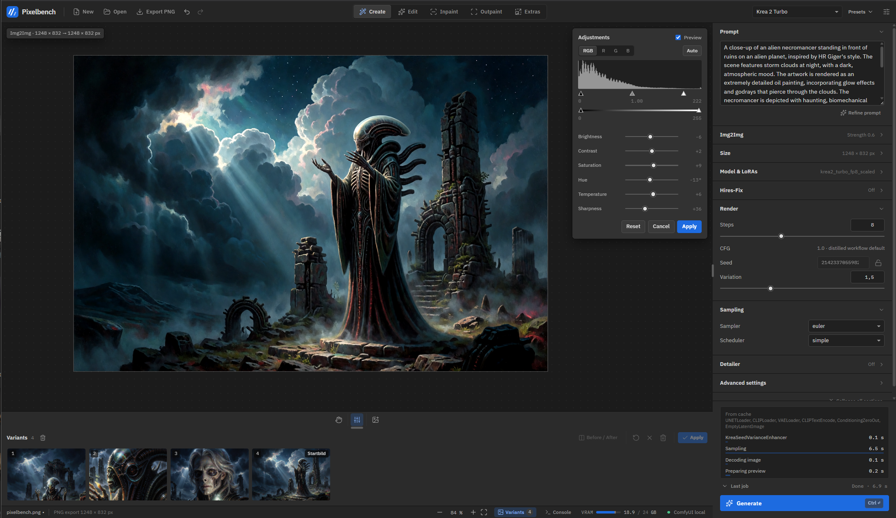

# Pixelbench

  

Pixelbench started as a "just for me" project: a way to streamline my own generative AI workflows and shape the tools around how I actually work. Then a few friends saw it and wanted it too, so I turned it into a complete, polished app.

It brings together the concepts and features I found most useful in ComfyUI, Automatic1111 / sd-webui-forge, SwarmUI and InvokeAI: the flexibility of ComfyUI's node workflows, the fast prompt-to-image loop and hires fix of the A1111 family, SwarmUI's idea of a friendly front end on top of ComfyUI, and the canvas-first editing of InvokeAI. All of it sits in a modern interface laid out like a classic image editor such as Photoshop, with tools on the left, settings on the right and your image in the middle. On top of that, it builds in a handful of community extensions and custom nodes that I found to be a good fit, such as LanPaint for inpainting, Ultimate SD Upscale for tiled hires fix and GGUF loaders for quantized models (see [Third-party components](docs/third-party.md)).

None of these tools are bad, and I still like all of them. For my workflow, though, each one on its own was either too bloated, too cluttered or too complicated. Pixelbench is my attempt to keep the parts I use every day and leave out the rest.

Pixelbench is a local image editor for Windows. It drives a private ComfyUI process that it starts and stops itself, so you get create, edit, inpaint, outpaint and upscale tools on one canvas without building node graphs. Everything runs on your machine. Images and prompts never leave it.

> [!NOTE]
> **This is a first beta.** So far it has only been tested on my own machine: Windows 11 with an RTX 4090. Other GPUs, smaller amounts of VRAM and other ComfyUI setups may well run into problems I have never seen. Bug reports, feature requests and feedback of any kind are very welcome, so please open an issue.

## Features

- Create images from a prompt, with optional hires fix and a reference or template image (img2img).
- Edit an image with an instruction and up to 15 image references (Qwen-Image Edit 2.1).
- Inpaint with a mask brush, outpaint by dragging the frame handles, and paint color sketches on a drawing layer.
- Upscale with an upscale model or Lanczos, and view the metadata stored in PNG files (Automatic1111's PNG info).
- Variants strip, before/after compare, undo and redo, image adjustments with live histogram, LoRAs and per-component model selection.
- Profiles are plain JSON files in `profiles/` that point to ComfyUI API workflows in `workflows/`.

## Supported models

| Model family      | Profiles                                                   |
| ----------------- | ---------------------------------------------------------- |
| Krea 2 Turbo | Text to image, image to image, edit, inpainting, LanPaint inpainting |
| Qwen-Image 2.1    | Text to image, image to image and edit, base and Turbo; Turbo Fun ControlNet for edit, inpainting and outpainting |
| Z-Image           | Text to image and image to image, base and Turbo |
| MOSS-Image        | Text to image and image to image, base and Turbo; Turbo inpainting and LanPaint inpainting |
| FLUX.2 [klein] 4B | Edit                                                       |
| FLUX.1 Fill       | Inpainting and outpainting                                 |
| SDXL              | Text to image, image to image, inpainting and outpainting |
| Upscale models    | ESRGAN-style upscalers through ComfyUI, or plain Lanczos   |

Pixelbench does not download models. It uses the weights you already have in your ComfyUI model folders, and each profile shows which files it is missing. See [Profiles and models](docs/profiles-and-models.md).

**Video models are not supported, and that is not planned.** Pixelbench is built for still images, so please don't open feature requests for video. Maybe one day I'll build a "Videobench" that is made for exactly that. :)

## Prerequisites

- Windows 10 or 11.
- A working ComfyUI install: Comfy Desktop, ComfyUI Desktop, the portable build or a manual install. Its Python environment must have PyTorch.
- An NVIDIA GPU with CUDA is strongly recommended. Without CUDA, generating is very slow.
- Internet access during the install.
- Node.js 24 or newer. The installer offers to install it with winget.

ComfyUI is a separate prerequisite. Pixelbench uses it but never modifies it.

## Install

1. Get the folder: `git clone` this repository or download and unpack a release zip.
2. Double-click `install.cmd`.

The installer finds ComfyUI, downloads the custom nodes Pixelbench needs, builds the editor and offers a desktop shortcut. See [Installation](docs/installation.md) for the details.

## Start

Double-click `Pixelbench.cmd` or the desktop shortcut. It opens Pixelbench in your default browser at <http://127.0.0.1:3720>. The first start can take up to 90 seconds while the private ComfyUI process loads its nodes. Close the window or press Ctrl+C to stop the server.

## Update or repair

Run `install.cmd` again. It only changes what is missing or outdated. To update a git checkout, run `git pull` first.

## Uninstall

Delete the Pixelbench folder and the desktop shortcut `Pixelbench.lnk`. ComfyUI is never modified, so there is nothing to undo there.

## Documentation

- [Documentation index](docs/README.md)
- [Installation](docs/installation.md)
- [Getting started](docs/getting-started.md)
- [Editor and modes](docs/editor.md)
- [Keyboard shortcuts](docs/keyboard-shortcuts.md)
- [Profiles and models](docs/profiles-and-models.md)
- [Settings](docs/settings.md)
- [Development](docs/development.md)
- [Third-party components](docs/third-party.md)

## License

Pixelbench is released under the [MIT License](LICENSE). The custom nodes the installer downloads have their own licenses, see [Third-party components](docs/third-party.md).
